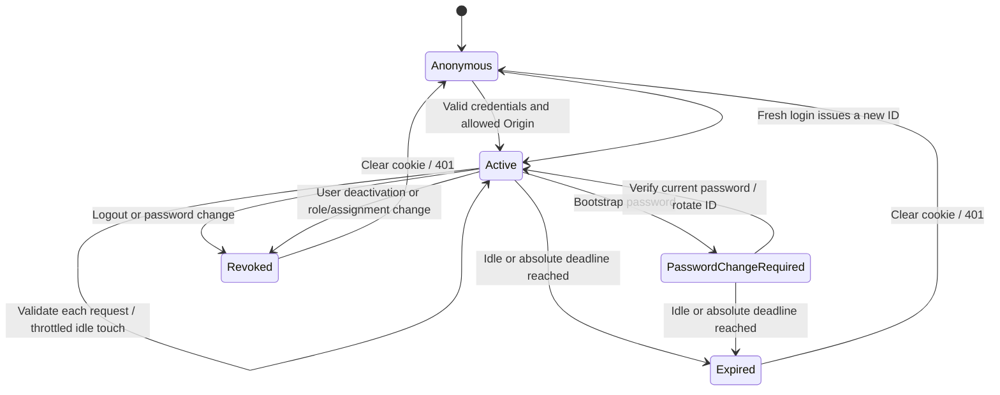

# Authentication and session management — Module 2

Module 2 adds password authentication and SQL-backed opaque sessions. It provides /login, /change-password and a protected /dashboard placeholder. Module 3 adds user administration and center/cluster scoping; see RBAC.md. Business dashboard features, SSO and AD remain unimplemented.

## Endpoints

All endpoints use /api/v1/auth and Cache-Control: no-store, including error responses.

| Method/path           | Access                          | Result                                                                                             |
| --------------------- | ------------------------------- | -------------------------------------------------------------------------------------------------- |
| POST /login           | Public, allowed Origin required | 200 profile and new HttpOnly cookie                                                                |
| GET /me               | Authenticated                   | ID, username, displayName, role code, permission codes, mustChangePassword, idle/absolute expiries |
| GET /csrf             | Authenticated                   | Session-bound csrfToken                                                                            |
| POST /logout          | Authenticated + Origin + CSRF   | 204; revoke session and clear cookie                                                               |
| POST /change-password | Authenticated + Origin + CSRF   | 200 profile; change password, revoke all previous sessions and issue new cookie                    |

Username input is trimmed, case-insensitive, 1–100 characters. Password inputs are 1–128 characters before hashing; new passwords also follow the policy below. Unknown properties are rejected. Profiles are explicitly mapped DTOs; never serialize request.user or a Session entity.

## Lifecycle



Session IDs are crypto.randomBytes(32) encoded as base64url. Only their SHA-256 hex hashes are persisted. The raw ID is held transiently on server requests and sent only in an HttpOnly cookie, never in JSON, HTML or browser storage.

Validation checks revocation, both expiry timestamps, active/unlocked user, active role and an authorization fingerprint. Role/permission data are loaded on every request. Idle expiry is extended only when last_seen_at is at least SESSION_TOUCH_INTERVAL_SECONDS old, using a conditional SQL update; it never exceeds absolute expiry. Previously validated in-flight requests cannot be recalled by logout; password changes additionally revalidate the session inside the write transaction.

Login ignores incoming session identity and revokes any matching previous cookie only after successful authentication. A new ID is always generated. Password changes verify the old password under a user-row lock, update the user, revoke every old session (including the current ID), issue a new ID and append redacted audit records in the same transaction.

The additive SessionAuthorization migration introduces nullable sessions.authorization_hash. Module 3 fingerprints role identity/scope and direct assignment IDs. Role/assignment changes revoke all sessions; legacy fingerprints require a fresh login. Role permission edits preserve sessions as explicitly required by Module 3: grants are loaded fresh on every request and are excluded from the fingerprint. See RBAC.md for the administration transaction safeguards.

## Cookies and CSRF

SESSION_COOKIE_NAME defaults to sid. Production sends __Host-sid (or __Host- plus the configured unprefixed name), Secure, HttpOnly, SameSite=Lax, Path=/, with no Domain or maxAge. These are browser-session cookies; only the server decides idle/absolute validity. Clearing uses the same path/security attributes.

All POST/PUT/PATCH/DELETE requests require exact Origin matching, or Referer-origin fallback only when Origin is absent. Missing, null, malformed and unapproved origins are denied. Login is exempt only from the CSRF token requirement.

Other mutations require X-CSRF-Token = base64url(HMAC-SHA256(CSRF_SECRET, raw session ID)). Verification bounds length and uses timingSafeEqual. The browser fetches a fresh token before each mutation and keeps it only in the current function call. A rotated cookie makes previous tokens invalid. No cookie/token uses localStorage or sessionStorage.

Browsers use the Next origin exclusively. Next rewrites /api/* to API_URL. The API has no permissive CORS configuration and should be private at the network boundary. Origin checks are CSRF protection, not a defense against non-browser attackers.

## Configuration

API settings are validated at startup. Real settings belong in apps/api/.env, never in source control.

| Variable                       | Default / requirement                                                                        |
| ------------------------------ | -------------------------------------------------------------------------------------------- |
| SESSION_COOKIE_NAME            | sid; unprefixed safe token, maximum 40 characters                                            |
| SESSION_IDLE_TIMEOUT_MINUTES   | 30                                                                                           |
| SESSION_ABSOLUTE_TIMEOUT_HOURS | 8; must be at least idle timeout                                                             |
| SESSION_TOUCH_INTERVAL_SECONDS | 60; must be shorter than idle timeout                                                        |
| CSRF_SECRET                    | Required; at least 32 characters, same secret across API replicas                            |
| ALLOWED_ORIGINS                | Required comma-separated exact origins, no trailing slash/path/wildcard; HTTPS in production |
| TRUST_PROXY                    | false; boolean or hop count, 0–99                                                            |
| LOGIN_MAX_FAILURES             | 5                                                                                            |
| LOGIN_LOCKOUT_MINUTES          | 15                                                                                           |
| PASSWORD_MIN_LENGTH            | 12 minimum, maximum 128                                                                      |
| ARGON2_MEMORY_KIB              | 19456 minimum (19 MiB)                                                                       |
| ARGON2_TIME_COST               | 2 minimum                                                                                    |
| ARGON2_PARALLELISM             | 1                                                                                            |
| LOGIN_RATE_WINDOW_SECONDS      | 60                                                                                           |
| LOGIN_IP_LIMIT                 | 60 attempts per window                                                                       |
| LOGIN_USERNAME_LIMIT           | 20 attempts per window                                                                       |
| SESSION_RETENTION_DAYS         | 7                                                                                            |
| LOGIN_ATTEMPT_RETENTION_DAYS   | 90                                                                                           |

The web app needs API_URL and the same unprefixed SESSION_COOKIE_NAME. API and Next production modes must agree about Secure/__Host- cookies. Local development uses HTTP and sid; production needs HTTPS.

Generate CSRF_SECRET with a cryptographically secure generator and write it directly to the ignored API environment file. Never paste or print production secrets into logs. Rotating it invalidates existing CSRF tokens; clients fetch new tokens for each mutation.

TRUST_PROXY must reflect the exact trusted proxy chain. Do not enable true on a directly exposed API or accept spoofed forwarded headers; trusted ingress must replace/sanitize them. With false, proxied local development logins share the proxy's IP rate bucket. The API client-IP logging and IP throttles both use Express's configured req.ip.

## Login and password decisions

@nestjs/throttler supplies per-process IP/username counters; SQL login_attempts supplies persisted cross-replica limits. Schema-specific sp_getapplock locks serialize counters, followed by pessimistic user-row locks for failed-login updates. Every credential attempt, including throttled attempts, is recorded. Malformed/Origin-rejected login submissions record only a bounded attempted username and reason, without hashing or storing their password. Database outages can prevent an attempt record; authentication still fails closed.

Unknown users still execute argon2 verification against a startup-generated dummy hash. Wrong password, unknown/inactive user and locked user have identical 401 bodies. Correlation IDs remain in X-Request-Id, not varying 401 bodies. Dummy work reduces timing differences; database/network timing cannot be perfectly constant.

Lockout starts after N consecutive failures. Attempts during lockout do not prolong it. Successful login resets failures; the first failure after an expired lockout begins a new sequence. Separate IP/username throttles return 429. Argon2id rehash-on-login increases configured work factors while preserving any stronger stored factor.

New passwords are 12/configured-minimum through 128 characters, different from the username (case-insensitive) and current password, and not in a small bundled common-password list. No composition rule is imposed. The UI provides a baseline 12-character hint; the API enforces any higher configured minimum. Bootstrap/admin seeding remains Module 1 behavior and forces password change.

When must_change_password is set, authenticated endpoints are blocked with PASSWORD_CHANGE_REQUIRED except me/csrf/change-password/logout. Operational public health probes remain public. No credentials can bypass a declared permission requirement.

## Guards and extension points

Global guard order: OriginGuard, AuthGuard, CsrfGuard, PasswordChangeGuard, PermissionsGuard.

```ts
@Public() // Only deliberately open routes; mutation Origin/CSRF policy still applies.
@Get('public-information')
publicInformation() { /* ... */ }

@RequirePermissions('inventory.edit') // All declared codes are required.
@Post('inventory')
editInventory(@CurrentUser() user: Principal) { /* Delegate to a scoped service. */ }
```

Use Public from common/public.decorator and CurrentUser/RequirePermissions from auth/auth.decorators. Only the actual login route has the internal LoginEndpoint marker that exempts its CSRF header. Do not add PasswordChangeAllowed to business controllers.

Module 3 resolves request.scope through ScopeService on every authenticated request. Center-bound business queries must use CenterScope.applyToQuery, including for ALL roles. The inventory/dashboard business endpoints remain for later modules. SessionService exports create, validate, touch, revoke and revokeAllForUser; sessionId arguments are raw IDs held only in server memory. Revocation reasons are a fixed enum.

Password verification is separated into PasswordService; AuthService coordinates account state, audits and session issuance. A future SSO provider can resolve a local user and reuse session issuance while preserving these validations. No SSO/AD/MFA/recovery feature is implied.

## Logging, auditing and cleanup

Auth event logs contain event name, userId, ip and requestId only. The explicit Module 2 requirement permits these identifiers despite the general no-PII rule; usernames, emails, passwords, hashes, session identifiers and CSRF tokens remain prohibited. Request logs omit headers, bodies and URLs and redact sensitive fields defensively.

User-state writes and audit rows share one SQL transaction. Password audit values are always [REDACTED]; UPDATE audit rows are per changed field. Runtime audit_logs permissions remain append-only (no UPDATE/DELETE).

An hourly @nestjs/schedule task deletes sessions whose idle/absolute expiry or revocation is more than the retention period old and attempts older than their retention period. Deletes are idempotent across replicas. Runtime permissions must allow deletion from sessions/login_attempts, never audit_logs.

## Web behavior

Next 16 uses proxy.ts (the renamed middleware convention). It checks cookie presence only for a convenient redirect; getSession forwards the cookie server-side to the API for the actual check. Protected profiles are never cached. An invalid session redirects to /login?reason=expired with a visible message.

The client wrapper handles 401 similarly and redirects PASSWORD_CHANGE_REQUIRED to /change-password. An idle timer checks the API at the advertised expiry; it does not poll periodically to keep an idle session alive. Network failure alone does not prove expiry.

Page scripts use a per-request nonce CSP and dynamic rendering; production has no script unsafe-inline/unsafe-eval. Inline styles remain permitted. Login and change-password forms never expose cookies or persist passwords/tokens.

## Running and testing

```powershell
pnpm install --frozen-lockfile
pnpm db:migrate
# Configure CSRF_SECRET, ALLOWED_ORIGINS and the other API settings.
# Optional: configure SEED_ADMIN_* then pnpm db:seed.
pnpm dev

pnpm lint
pnpm typecheck
pnpm test
pnpm build

# With TEST_DATABASE_URL configured in apps/api/.env:
pnpm --filter @handset/api exec jest --runInBand test/auth.integration.spec.ts
pnpm --filter @handset/api exec jest --runInBand test/database.integration.spec.ts
```

Without TEST_DATABASE_URL, SQL suites skip with a clear message. They never implicitly fall back to the application database. Each creates a uniquely named schema, migrates up, uses synthetic users/data, then rolls back all migrations and removes only its schema. They require schema/table creation permissions and must not target production. The injectable Clock covers expiry without wall-clock waits.

Unit tests cover session hashing, CSRF, origins, password policy/dummy verification, config/cookies/permissions and the browser fetch wrapper. SQL tests cover production cookie flags, generic errors, throttling, concurrency/lockout, fixation, expiry/touch, CSRF, logout, password rotation, permission changes and retention.

## Dependencies and references

Added @nestjs/schedule for hourly retention jobs; @nestjs/throttler for in-memory rate-limit counters; cookie-parser and @types/cookie-parser for typed HttpOnly cookie parsing. Existing argon2 supplies password hashing.

[Nest rate limiting](https://docs.nestjs.com/security/rate-limiting), [Next proxy convention](https://nextjs.org/docs/app/api-reference/file-conventions/proxy), and the bundled Next docs guided framework-specific integration.

Optional real Next.js proxy HTTP smoke (with TEST_DATABASE_URL set): set AUTH_WEB_SMOKE=true, then run the auth integration suite. It uses a separate .next/auth-smoke build directory and temporary API/web ports. It checks redirects, login, server-rendered identity, CSRF, logout and rejection of the old cookie; it does not automate browser interaction.

## Module 3 superseding behavior

Module 3 implements user administration and scope resolution; see [RBAC.md](RBAC.md). Role permission changes now preserve sessions and reload grants every request. The authorization fingerprint binds role identity/scope and direct assignment IDs, excluding permission codes and role row version. User role/assignment changes revoke all sessions; old Module 2 fingerprints require one fresh login. AuthGuard also resolves request.scope. Administrative APIs use the same CSRF and no-store protections.
