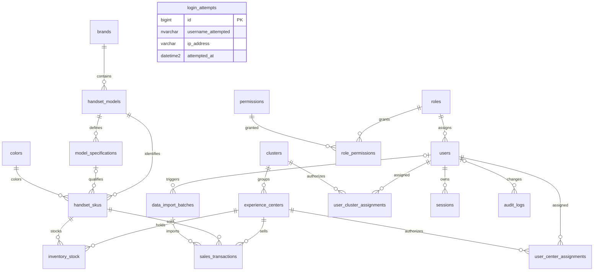

# Database layer — Module 1

19 SQL Server tables, TypeORM entities, one reversible migration, DB commands and idempotent seeds. No controllers, authentication logic, UI or customer-feedback tables.

## Configuration

Runtime uses DATABASE_URL; DB commands use DATABASE_MIGRATION_URL with fallback to DATABASE_URL. The existing parser handles URL/ADO strings. DB_SCHEMA defaults to dbo and must match a letter/underscore followed by letters/digits/underscores (maximum 64 characters). Entities, FKs and schema_migrations use that schema. Synchronization and automatic migrations remain disabled.

The custom naming strategy maps camelCase properties to snake_case columns. Migration commands create the schema before TypeORM creates its ledger. Down removes module tables and FKs, retaining schema/ledger and unrelated objects. **Reverting the initial migration deletes all module data**; only use for disposable data or a reviewed rollback.

## ER diagram

All business/master created_by and updated_by columns have nullable NO ACTION FKs to users; these repeated edges are omitted for readability.



## Tables

Business/master tables have UTC datetime2(3) created_at/updated_at and nullable created_by/updated_by. Masters use is_active and integer @VersionColumn row_version. Join tables carry audit columns. Users are deactivated, inventory quantities can become zero, and operational histories/facts are retained rather than soft-deleted; deletion is not exposed by this module.

### clusters

Editable cluster master, initially empty pending approved definitions.

Columns: `id`, `code`, `name`, `is_active`, `row_version`, `created_at`, `updated_at`, `created_by` (nullable), `updated_by` (nullable).

### experience_centers

Extensible centers, initially the ten BRD centers with NULL cluster assignments.

Columns: `id`, `code`, `name`, `short_name` (nullable), `cluster_id` (nullable), `is_active`, `row_version`, `created_at`, `updated_at`, `created_by` (nullable), `updated_by` (nullable).

### brands

Case-insensitive standardized brand names.

Columns: `id`, `name`, `is_active`, `row_version`, `created_at`, `updated_at`, `created_by` (nullable), `updated_by` (nullable).

### handset_models

Models unique within each brand.

Columns: `id`, `brand_id`, `name`, `is_active`, `source_system` (nullable), `row_version`, `created_at`, `updated_at`, `created_by` (nullable), `updated_by` (nullable).

### model_specifications

Model-specific labels; positive optional RAM/storage values.

Columns: `id`, `model_id`, `label`, `ram_gb` (nullable), `storage_gb` (nullable), `notes` (nullable), `is_active`, `source_system` (nullable), `row_version`, `created_at`, `updated_at`, `created_by` (nullable), `updated_by` (nullable).

### colors

Case-insensitive standardized colors.

Columns: `id`, `name`, `is_active`, `source_system` (nullable), `row_version`, `created_at`, `updated_at`, `created_by` (nullable), `updated_by` (nullable).

### handset_skus

Unique model/specification/color combinations; composite FK prevents cross-model specifications.

Columns: `id`, `model_id`, `specification_id` (nullable), `color_id`, `sku_code`, `is_active`, `source_system` (nullable), `row_version`, `created_at`, `updated_at`, `created_by` (nullable), `updated_by` (nullable).

### inventory_stock

Nonnegative stock per center/SKU with integer optimistic version.

Columns: `id`, `center_id`, `sku_id`, `quantity_available`, `last_stock_update_at`, `source_system` (nullable), `row_version`, `created_at`, `updated_at`, `created_by` (nullable), `updated_by` (nullable).

### sales_transactions

UTC sales facts, explicit PKT sale date and source-reference deduplication.

Columns: `id`, `center_id`, `sku_id`, `sold_at`, `sale_date`, `quantity`, `sales_type`, `dispatch_source`, `source_system`, `external_ref`, `import_batch_id` (nullable), `created_at`, `updated_at`, `created_by` (nullable), `updated_by` (nullable).

### data_import_batches

Import status/counters; finished successful/partial batches support last-refresh reporting. Distinguish partial from complete refreshes.

Columns: `id`, `source_system`, `kind`, `file_name` (nullable), `started_at`, `finished_at` (nullable), `status`, `rows_received`, `rows_accepted`, `rows_rejected`, `error_summary` (nullable), `triggered_by` (nullable), `created_at`, `updated_at`, `created_by` (nullable), `updated_by` (nullable).

### roles

Role defaults and scope definitions; not an authorization implementation.

Columns: `id`, `code`, `name`, `scope_type`, `can_edit_default`, `is_active`, `row_version`, `created_at`, `updated_at`, `created_by` (nullable), `updated_by` (nullable).

### permissions

Stable capability codes.

Columns: `id`, `code`, `description`, `is_active`, `row_version`, `created_at`, `updated_at`, `created_by` (nullable), `updated_by` (nullable).

### role_permissions

Composite-key role grants.

Columns: `role_id`, `permission_id`, `created_at`, `updated_at`, `created_by` (nullable), `updated_by` (nullable).

### users

Identity records with hash, lockout and password-lifecycle fields for future auth.

Columns: `id`, `username`, `email` (nullable), `display_name`, `password_hash`, `role_id`, `is_active`, `must_change_password`, `failed_login_count`, `locked_until` (nullable), `last_login_at` (nullable), `password_changed_at`, `row_version`, `created_at`, `updated_at`, `created_by` (nullable), `updated_by` (nullable).

### user_center_assignments

Explicit center assignments.

Columns: `user_id`, `center_id`, `created_at`, `updated_at`, `created_by` (nullable), `updated_by` (nullable).

### user_cluster_assignments

Explicit cluster assignments.

Columns: `user_id`, `cluster_id`, `created_at`, `updated_at`, `created_by` (nullable), `updated_by` (nullable).

### sessions

SHA-256 session hashes only, plus lifecycle and revocation metadata.

Columns: `id`, `session_hash`, `user_id`, `created_at`, `last_seen_at`, `idle_expires_at`, `absolute_expires_at`, `revoked_at` (nullable), `revoked_reason` (nullable), `ip_address`, `user_agent`.

### login_attempts

Attempt history for future username/IP throttling.

Columns: `id`, `username_attempted`, `ip_address`, `success`, `attempted_at`, `failure_reason` (nullable).

### audit_logs

Append-only field-level changes. NULL actor is reserved for system actions.

Columns: `id`, `entity_type`, `entity_id`, `action`, `field_name` (nullable), `old_value` (nullable), `new_value` (nullable), `user_id` (nullable), `changed_at`, `request_id`, `ip_address` (nullable).

## SQL Server constraints and workarounds

- int IDENTITY keys for master/user/inventory tables; bigint IDENTITY for sales, batches, sessions, login attempts and audit history. Bigint entity IDs are strings to avoid JavaScript precision loss. Join tables use composite PKs.
- Explicit Latin1_General_100_CI_AS collation makes unique names/usernames case-insensitive regardless of server defaults. Email uses a filtered unique index WHERE email IS NOT NULL to allow multiple missing emails.
- SKU uniqueness uses two filtered unique indexes: (model_id, specification_id, color_id) for non-null specifications and (model_id, color_id) for NULL. The composite FK references specifications(id, model_id), preventing a specification from another model.
- All FKs use NO ACTION to avoid multiple cascade paths and accidental deletion. Nullable audit-user FKs are created after all tables to resolve users/master cycles.
- CHECK constraints enforce quantities, enums, import counts, session lifetimes and lowercase 64-character hex session hashes. sale_date equals CONVERT(date, DATEADD(minute, 300, sold_at)); the value is stored explicitly.
- row_version is an integer TypeORM version column, not binary SQL Server rowversion. Future edit repositories must atomically compare the expected version and increment it. VersionColumn alone does not reject stale writes; direct SQL must also maintain updated_at/updated_by/version.
- TypeORM cannot represent SQL Server INCLUDE columns. The sales date covering index uses fixed migration DDL and @Index synchronize:false; review generated migrations.
- The initial migration is a frozen snapshot and never imports current entity definitions.
- audit_logs is append-only: configure the runtime principal with SELECT/INSERT as needed and **no UPDATE/DELETE rights**. Do not invent a database principal in migrations. User IDs can be null only for system activity; future write services must supply their actor.
- Session user_agent is capped at 512 characters; future session logic must truncate before insertion. IP/username/session metadata are sensitive DB records, never application log content.

## Index rationale

| Index                                                               | Purpose                                  |
| ------------------------------------------------------------------- | ---------------------------------------- |
| Unique master names/codes and model/spec labels                     | Lookup and duplicate prevention          |
| Centers(cluster_id), users(role_id), reverse assignment/grant FKs   | Scoped access and permission lookup      |
| Filtered SKU uniqueness and SKU(color_id)                           | Variant deduplication and drill-down     |
| Stock unique(center_id, sku_id), stock(sku_id)                      | Center stock and cross-center SKU totals |
| Sales unique(source_system, external_ref)                           | Import deduplication                     |
| Sales(center_id, sale_date)                                         | Center Day-1/MTD/YTD                     |
| Sales(sku_id, sale_date)                                            | Product/date analysis                    |
| Sales(sale_date) INCLUDE(center_id, sku_id, quantity, sales_type)   | Cover date-based dashboard totals        |
| Sales(import_batch_id)                                              | Reconciliation                           |
| Batches(kind, status, finished_at)                                  | Latest refresh                           |
| Sessions(user_id), (idle_expires_at), (absolute_expires_at)         | Revocation and expiry cleanup            |
| Login(username_attempted, attempted_at), (ip_address, attempted_at) | Future account/IP throttling             |
| Audit(entity_type, entity_id, changed_at), (user_id, changed_at)    | Entity/actor history                     |

## Seed behavior and assumptions

roles.config.ts contains editable role/permission/center/brand defaults. clusters.json intentionally has empty clusters and centerToCluster with a TODO. Supply approved cluster codes and center-code mappings before first seed. Existing records and assignments are preserved. Module 4 seeds add missing default role grants without deleting custom grants; this restores intentionally removed defaults when reseeding.

SYSTEM_ADMIN is a technical role outside the BRD and gets all permissions. Managers/supervisors initially get scoped inventory editing, dashboards and exports; masterdata.create now defaults to managers and administrators; masterdata.manage/import.run/users.manage default to administrators. OTHER_STAKEHOLDER now defaults to ASSIGNED (Module 3), with no access until approved center or cluster assignments. The Module 3 migration updates the earlier CENTER default.

All three SEED_ADMIN_USERNAME/EMAIL/PASSWORD settings are required to create an administrator; absent settings print a skip, partial settings fail. Passwords must have at least 12 characters and use argon2id (19 MiB, two iterations, parallelism one). must_change_password=true. Existing admin credentials, role and status are never overwritten. This is seed provisioning, not login/auth logic.

sales_type is assumed to be one of CASH/INSTALLMENT/FNF per transaction. dispatch_source is one of WAREHOUSE/EXPERIENCE_CENTER, with no inferred dispatching-location ID or accounting semantics. A later requirement may add warehouse/source-center FKs or separate product classification.

Demo requires SEED_DEMO_DATA=true and NODE_ENV other than production. It creates two fictional DEMO models per brand, two specifications/model, three colors, 60 SKUs, inventory for ten centers and about 90 dates/900 sales. The deterministic sample uses 88 recent PKT dates plus explicit Dec 31/Jan 1 anchors; it is intentionally not a continuous 90-day window, so October runs still exercise year boundaries.

Demo-capable masters/inventory also have source_system='DEMO' for safe ownership tracking. Existing colors and baseline brands/centers are preserved. A batch marker prevents repeated sample insertion. Cleanup removes only marked rows in FK-safe order, retains audit history, and appends DELETE audits. Non-demo references to demo masters cause the entire cleanup to roll back. Cleanup is forbidden in production.

Seed/clear runs are atomic with a schema-specific sp_getapplock. Data and their audit writes share the same transaction, with per-field UPDATE audits and null actors for system work. Seed output and audits never contain passwords, hashes or connection strings.

## Commands

From repository root, with apps/api/.env configured:

```powershell
pnpm install --frozen-lockfile
pnpm --filter @handset/shared build
pnpm db:status
pnpm db:migrate
pnpm db:seed
pnpm db:seed

# Explicit reviewed rollback:
pnpm db:revert

# Future changes:
pnpm db:migration:create src/database/migrations/DescribeChange
pnpm db:migration:generate src/database/migrations/DescribeChange

# Non-production only:
pnpm db:seed:demo:clear

pnpm lint
pnpm typecheck
pnpm test
```

The same DB script names work in apps/api. Create produces a skeleton; implement up/down. Generate uses migration credentials and entity metadata; inspect generated SQL. Status reports pending migrations without applying them.

## Verification

Set TEST_DATABASE_URL in apps/api/.env or the environment for integration tests; otherwise the suite prints a clear skip reason. Tests never silently fall back to DATABASE_URL. The suite uses a unique handset_test_* schema in the test database, requires CREATE SCHEMA/table permissions, ignores application migration credentials, and removes only its own schema afterward. It never drops a database. Run in a non-production environment.

Coverage includes up/down/up, duplicate sales references, negative/zero quantities, nullable/non-null duplicate SKUs, cross-model specifications, case-insensitive names, nullable emails, PKT sale_date consistency, invalid enums, seed-twice idempotency and demo cleanup. Metadata/naming/schema/seed configuration/date-generation tests need no database.

Live verification on the configured empty application database is separate and guarded by an empty-table check before any rollback.

## References and dependency

[TypeORM entity/version columns](https://typeorm.io/docs/entity/entities/), [TypeORM indexes](https://typeorm.io/docs/advanced-topics/indices/), [SQL Server foreign keys](https://learn.microsoft.com/en-us/sql/relational-databases/tables/primary-and-foreign-key-constraints?view=sql-server-ver16).

Added dependency: argon2 implements the required argon2id hash for optional admin seeding.

SQL Server date binding workaround: database entry points pin the Node process timezone to UTC before driver operations. TypeORM otherwise interprets date-only strings in the workstation timezone, which can shift stored sale_date. PKT calculations remain explicit in the shared date utility.

## Module 1 verification results

Validated against the reachable SQL Server with an explicitly selected temporary test schema (TEST_DATABASE_URL was supplied only to that test process). The integration suite passed constraints, up/down/up, repeated baseline/demo seeds, argon2id administrator creation and password preservation, and repeated demo cleanup. Its schema was removed afterward.

A separate empty-database guard passed before applying up/down/up to the application database. It is left migrated with 10 centers, 6 roles, 7 permissions and 5 brands. Two baseline seed runs produced identical counts in all 19 tables, including audit history. Admin provisioning was skipped because SEED_ADMIN_* is unset; demo data remained disabled. Entity/schema comparison reports zero pending DDL changes.

Repository validation: lint, strict typecheck, 58 unit/HTTP tests and production builds passed. The SQL integration suite also passed separately; ordinary pnpm test skips it with a message when TEST_DATABASE_URL is absent. The only new dependency is argon2 for administrator seed hashing.

## Module 2 schema addition

SessionAuthorization adds nullable sessions.authorization_hash (char(64)). It binds sessions to role/permission state; missing or changed fingerprints require fresh login. Existing database data is preserved. Its down method removes only that column. Authentication design and retention rules are documented in AUTH.md.

## Module 3 scope migration

AssignedScope expands ck_roles_0 to ALL/CLUSTER/CENTER/ASSIGNED and changes existing OTHER_STAKEHOLDER scope types to ASSIGNED with an atomic system audit. The seed default is now ASSIGNED. No user, inventory or history rows are deleted. Scope SQL uses OPENJSON and requires database compatibility level 130+. See [RBAC.md](RBAC.md) for rollback effects, administration semantics and verification.

## Module 4 catalog migration

`CatalogPrices1791792000000` adds nullable `handset_skus.price` (`decimal(12,2)`) with a nonnegative check constraint. It stores the global catalog selling price in PKR per SKU. Existing rows remain unpriced; no zero or guessed price is backfilled. Apply this migration before running the price-enabled API. Its down migration removes the price column and its constraint, losing stored prices while retaining the handset records.

Catalog1791705600000 adds persisted binary-collation name_key columns and unique indexes to brands/colors and parent-scoped models/specifications. Keys are backfilled using a frozen normalizer; collisions fail the transaction for manual resolution. The migration splits masterdata.edit into create/manage, preserves legacy customized grants, and adds new defaults. Down drops only these new keys/indexes and collapses new grants to legacy edit; business records and audits remain. Rollback can broaden create-only permission grants; review roles before restoring old code. Existing wide display columns are retained for legacy compatibility; new API length limits are stricter.

Canonical colors are now seeded. Seeds compute normalized keys for baseline/demo masters and add missing default permission mappings without removing extra custom grants. The catalog imports reuse data_import_batches with kind MASTER. No inventory or sales schema changes are introduced. See [CATALOG.md](CATALOG.md) for endpoints, global catalog/scoped stock-detail boundaries and validation commands.
